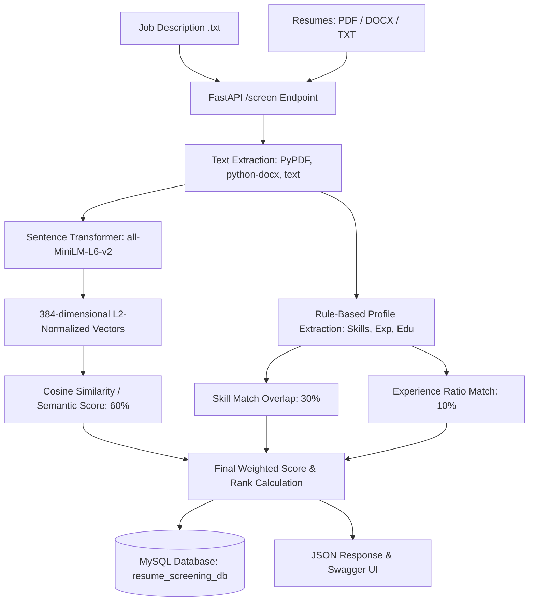

# Resume Screening Agent

An AI-powered, explainable Resume Screening Agent built with **Python, FastAPI, MySQL, SQLAlchemy, and Sentence Transformers (`all-MiniLM-L6-v2`)**. The system extracts candidate profile information from resumes (PDF, DOCX, TXT), embeds resumes and job descriptions into high-dimensional semantic vector spaces, calculates cosine similarity, and computes a multi-factor weighted ranking score saved in MySQL.

Built for the **Tech Mahindra Digital Catalyst – AI Engineer** evaluation.

---

## 1. Project Overview & Features

- **Multi-Format Ingestion**: Supports `.txt`, `.pdf`, and `.docx` resumes with automated text extraction and graceful error handling for corrupt/empty files.
- **Deep Semantic Matching**: Generates dense vector embeddings using the pretrained `all-MiniLM-L6-v2` Sentence Transformer.
- **Explainable Weighted Scoring**:
  - **Semantic Similarity (60%)**: Captures conceptual alignment and contextual relevance between the job description and candidate resume.
  - **Skills Match (30%)**: Deterministic overlap ratio against key technical competencies.
  - **Experience Score (10%)**: Ratio of candidate experience mentioned against target job experience.
- **MySQL Enterprise Persistence**: Saves jobs, candidate profiles (skills, experience, education, contact info), screening sessions, and ranked results with ACID transactions.
- **Interactive REST APIs**: Fully documented OpenAPI / Swagger UI endpoints for screening, retrieving jobs, inspecting sessions, and checking candidate screening histories.
- **Decision Support (Human-in-the-Loop)**: Designed strictly as an AI screening and ranking assistant for recruiters, not an automated hiring decision-maker.

---

## 2. Technology Stack

- **Language & Runtime**: Python 3.10+ (tested on Python 3.14)
- **API Framework**: FastAPI, Uvicorn, Pydantic
- **Deep Learning / NLP**: Sentence-Transformers (`all-MiniLM-L6-v2`), PyTorch, Hugging Face
- **Database & ORM**: MySQL, SQLAlchemy 2.0+, PyMySQL
- **File Parsing**: PyPDF, python-docx
- **Testing**: Pytest, FastAPI TestClient

---

## 3. Architecture & Workflow



---

## 4. Pretrained Model & Similarity Mathematics

### Why `all-MiniLM-L6-v2`?
`all-MiniLM-L6-v2` is a 6-layer BERT-derived transformer model fine-tuned on over 1 billion sentence pairs for semantic search and clustering:
- **Embedding Dimensionality**: 384 dimensions.
- **Latency & Footprint**: Ultra-lightweight (~80MB), fast CPU inference with low memory overhead.
- **Semantic Understanding**: Maps words and sentences describing equivalent engineering capabilities (e.g., "NLP classification" and "language modeling") to close regions in vector space, overcoming raw keyword matching limitations.

### Embeddings and Cosine Similarity
1. **L2 Normalization**: Each generated vector $\vec{u}$ and $\vec{v}$ is normalized such that $\|\vec{u}\|_2 = 1$.
2. **Cosine Similarity**:
   $$\text{cosine\_similarity}(\vec{u}, \vec{v}) = \frac{\vec{u} \cdot \vec{v}}{\|\vec{u}\|_2 \|\vec{v}\|_2} = \vec{u} \cdot \vec{v}$$
3. **Score Scaling**:
   $$\text{semantic\_score} = \max(0, \text{cosine\_similarity}) \times 100$$
4. **Final Weighted Score**:
   $$\text{final\_score} = (0.60 \times \text{semantic\_score}) + (0.30 \times \text{skill\_score}) + (0.10 \times \text{experience\_score})$$

---

## 5. Database Schema

The system uses `resume_screening_db` with four relational tables:

- **`jobs`**:
  - `job_id` (INT, Primary Key, Auto-increment)
  - `job_title` (VARCHAR(255))
  - `job_description` (LONGTEXT)
  - `created_at` (TIMESTAMP)
- **`candidates`**:
  - `candidate_id` (INT, Primary Key, Auto-increment)
  - `candidate_name` (VARCHAR(255))
  - `email` (VARCHAR(255))
  - `phone` (VARCHAR(30))
  - `skills` (TEXT)
  - `education` (TEXT)
  - `experience` (TEXT)
  - `created_at` (TIMESTAMP)
- **`screening_sessions`**:
  - `session_id` (INT, Primary Key, Auto-increment)
  - `job_id` (INT, Foreign Key -> `jobs.job_id`)
  - `total_candidates` (INT)
  - `screened_at` (TIMESTAMP)
- **`screening_results`**:
  - `result_id` (INT, Primary Key, Auto-increment)
  - `session_id` (INT, Foreign Key -> `screening_sessions.session_id`)
  - `candidate_id` (INT, Foreign Key -> `candidates.candidate_id`)
  - `semantic_score` (NUMERIC(6, 2))
  - `skill_score` (NUMERIC(6, 2))
  - `experience_score` (NUMERIC(6, 2))
  - `final_score` (NUMERIC(6, 2))
  - `candidate_rank` (INT)
  - *Constraint*: `UNIQUE KEY (session_id, candidate_id)`

---

## 6. Installation & Configuration

### Prerequisites
- Python 3.10+
- Running MySQL instance with `resume_screening_db` database created

### Step 1: Clone and Set Up Virtual Environment

```powershell
python -m venv .venv
.venv\Scripts\Activate.ps1
pip install -r requirements.txt
```

### Step 2: Configure Environment Variables (`.env`)
Create a `.env` file in the project root (a placeholder template):

```env
DB_HOST=localhost
DB_PORT=3306
DB_NAME=resume_screening_db
DB_USER=your_mysql_username
DB_PASSWORD=your_mysql_password
```

*(Note: Never commit sensitive credentials to source control)*

### Step 3: Verify Database and Model Setup

```powershell
python test_model.py
```
Expected output:
```text
SQLAlchemy models loaded successfully!
Tables: ['jobs', 'candidates', 'screening_sessions', 'screening_results']
```

---

## 7. How to Run the Application

### Start the FastAPI REST API
```powershell
uvicorn app.main:app --reload --host 127.0.0.1 --port 8000
```
- API Base URL: `http://127.0.0.1:8000`
- Interactive Swagger UI: `http://127.0.0.1:8000/docs`
- ReDoc Documentation: `http://127.0.0.1:8000/redoc`

### Run via Command-Line Interface (CLI)
```powershell
python run_screening.py --jd sample_data/job_description.txt --resumes sample_data/resumes --output outputs
```
Outputs saved to `outputs/ranked_candidates.json` and `outputs/ranked_candidates.csv`.

---

## 8. API Endpoints Documentation

| Method | Endpoint | Description |
| :--- | :--- | :--- |
| **GET** | `/health` | Check API health, model status, and live MySQL connectivity. |
| **POST** | `/screen` | Upload a JD (`.txt`) and multiple resumes (`.pdf`, `.docx`, `.txt`) to screen, rank, and store results in MySQL. |
| **GET** | `/jobs` | Retrieve all saved jobs with titles and creation timestamps. |
| **GET** | `/screenings/{session_id}` | Retrieve a specific screening session with all ranked candidates and component scores. |
| **GET** | `/candidates/{candidate_id}` | Retrieve candidate profile and historical screening results across all sessions. |

### Sample Swagger UI Workflow
1. Navigate to `http://127.0.0.1:8000/docs`.
2. Expand **`GET /health`** and click **Try it out** -> **Execute**. Verify database connection is active.
3. Expand **`POST /screen`**:
   - `job_description`: Upload `sample_data/job_description.txt`.
   - `resumes`: Select all files inside `sample_data/resumes/`.
   - Click **Execute**.
4. Inspect the ranked JSON response with scores, rankings, and reasoning.
5. Expand **`GET /screenings/{session_id}`** with `session_id=1` to view stored results.
6. Expand **`GET /candidates/{candidate_id}`** with `candidate_id=1` to view candidate profile and screening history.

---

## 9. Automated Testing

Run the comprehensive test suite:

```powershell
pytest -v
```

Test coverage includes:
- **`tests/test_api.py`**: Health endpoint, invalid JD file types, unsupported resume extensions, empty uploads.
- **`tests/test_parsers.py`**: TXT/DOCX/PDF parsing and unsupported file type rejection.
- **`tests/test_extractor.py`**: Profile fields, skill detection, and experience regex parsing.
- **`tests/test_ranker.py`**: Sentence Transformer embedding generation, cosine similarity, and rank ordering.
- **`tests/test_service.py`**: Folder runner validations.

---

## 10. Limitations & Future Improvements

- **Rule-Based Extraction**: Skills and experience extraction relies on regular expressions and curated vocabularies. Can be expanded with Named Entity Recognition (NER) models like spaCy.
- **Non-Text / Scanned Resumes**: Current parsers do not include OCR; scanned image-only PDFs require an OCR preprocessing pipeline (e.g. Tesseract).
- **Asynchronous Processing**: For high-volume enterprise pipelines (>10,000 resumes), background job queues (e.g. Celery / Redis) can decouple extraction from immediate request-response cycles.
